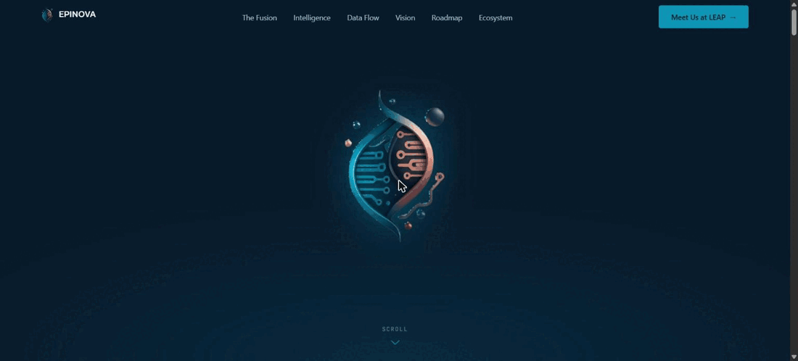
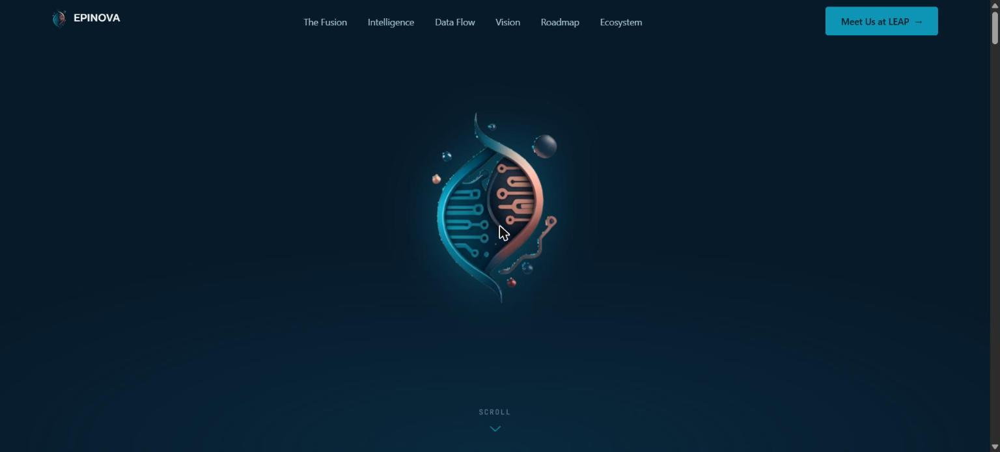
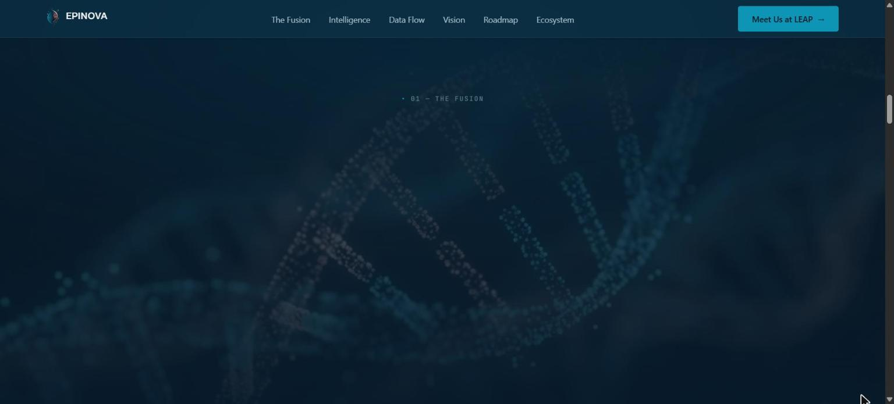
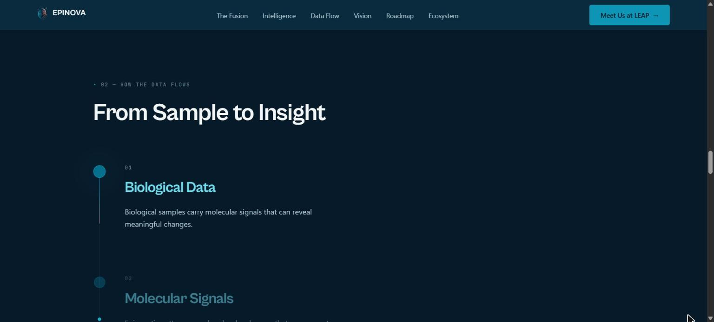
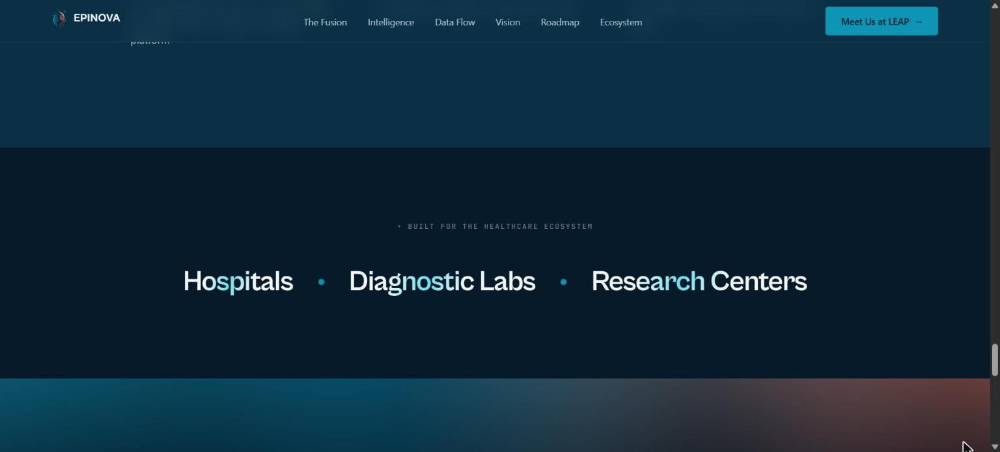
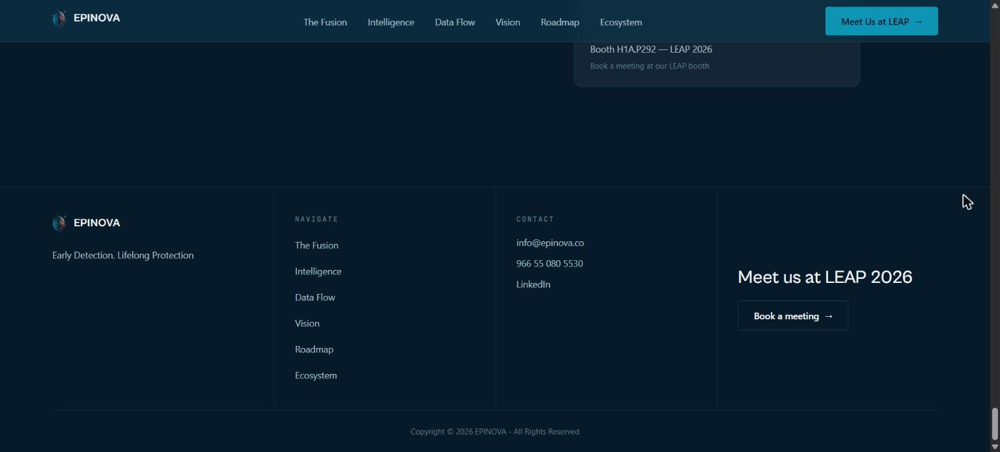

# EPINOVA — Landing Page

### A cinematic, scroll-driven marketing site for an AI cancer-detection company

*A dark, animation-first one-page site that turns a complex idea — early cancer detection through AI — into a calm, cinematic scroll. Built with Next.js, GSAP and WebGL, deployed on Vercel.*

**▶ Live:** **[epinova.co](https://epinova.co)**

---

### ▶️ A quick tour

*Hero → the fusion → how the data flows → the healthcare ecosystem → contact.*

---

## The brief

Epinova detects cancer early through AI. The landing page has to make that feel **trustworthy and advanced** without drowning the visitor in jargon — a single, quiet scroll that opens with a living DNA-and-circuit visual, dissolves it into a field of particles, then walks through the idea one calm section at a time and ends on a clear call to action.

The result is **motion-first but restrained**: a dark palette, one accent, generous space, and animation used to *explain* (sample → signal → insight) rather than to decorate.

---

## The interface

| | |
|:--:|:--|
|  | **Hero** — a WebGL DNA-and-circuit object glowing in the dark, with a quiet scroll cue. The whole hero is a live shader, not a video. |
|  | **The Fusion** — as you scroll, the hero dissolves into thousands of particles that reform into a double helix; section intros fade in on scroll. |
|  | **How the data flows** — a vertical timeline turns the pipeline into a story: *biological data → molecular signals → insight*, each step revealed as it enters the viewport. |
|  | **Built for the healthcare ecosystem** — a single typographic statement: hospitals · diagnostic labs · research centers. |
|  | **Contact** — a clean footer with a validated contact form (react-hook-form + zod) and a focused "meet us" call to action. |

---

## Highlights

- **Motion that explains, not distracts.** GSAP + ScrollTrigger drive section reveals and the sample→signal→insight timeline; [Lenis](https://github.com/darkroomengineering/lenis) smooths the scroll so the whole page reads as one continuous move.
- **Real-time WebGL, not a video loop.** The hero and particle fields are rendered with [OGL](https://github.com/oframe/ogl) (a lightweight WebGL library) — custom shaders for the glowing DNA/circuit object and the particle dissolve, so they stay crisp at any size and react to scroll.
- **Fast by construction.** Next.js 15 App Router with server components, `next/font`-style self-hosted faces via the Fontshare CSS API, image/metadata/OG handling built in, and `@vercel/analytics` for real-user metrics.
- **A form that behaves.** The contact form is fully typed and validated with `react-hook-form` + `zod`, posting to a configurable endpoint through public `NEXT_PUBLIC_*` env vars (no secrets in the client).
- **Designed in tokens.** Colour, type scale and spacing live as design tokens; one dark theme, one accent, consistent rhythm top to bottom.

---

## Tech stack

**Framework:** Next.js 15 (App Router, React 19, TypeScript — strict)
**Motion:** GSAP + ScrollTrigger · Lenis (smooth scroll)
**Graphics:** OGL (WebGL shaders — hero object + particle systems)
**Forms:** react-hook-form + zod
**UI/Icons:** @phosphor-icons/react · Fontshare-hosted display + text faces
**Platform:** Vercel (hosting + Analytics) · custom domain `epinova.co`

---

## Status & ownership

A **live, deployed** marketing site (**[epinova.co](https://epinova.co)**) designed and built for Epinova. This repository holds the front-end of that public site.

> The brand, copy and identity belong to Epinova. Screenshots are of the public live site.

*Early detection. Lifelong protection.*

